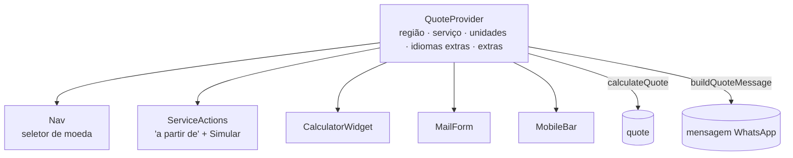

# Renderização e estado

## Componentes do servidor x do navegador

O Next renderiza **tudo no build**. Componentes marcados com `"use client"` também viram
JavaScript no navegador (para ter interação); os outros chegam só como HTML.

| Só HTML (servidor)                                         | Interativos (`"use client"`)                                  |
| ---------------------------------------------------------- | ------------------------------------------------------------- |
| Hero, Clients, Pains, Services, Security, Work, Calculator (seção), Process, About, Faq (seção), FinalCta, Footer, Logo, SplitWords, Icons | Nav, QuoteProvider, CalculatorWidget, MailForm, ServiceActions, MobileBar, FaqList, ScanBox, Clock, Reveal, PageEffects |

Padrão usado: a **seção** é do servidor e só o pedaço interativo é cliente. Ex.: `Services.tsx`
(servidor) renderiza os 8 cards e usa `ServiceActions.tsx` (cliente) só para o preço na moeda
atual e o botão "Simular".

Para economizar JavaScript, a página passa aos componentes cliente **só os textos que eles usam**
(ex.: `strings` em `src/app/[lang]/page.tsx`), não o dicionário inteiro.

## Estado compartilhado: `QuoteProvider`

Um único Context (`src/components/QuoteProvider.tsx`) guarda o que várias partes da página
precisam ao mesmo tempo:

- `quote` = `calculateQuote(...)` (função pura, [dominio/calculadora-e-precos.md](../dominio/calculadora-e-precos.md)).
- `message` / `waHref` = resumo no idioma atual, usado no botão do WhatsApp, na barra mobile e no e-mail.
- **Contagem animada** do total: `useCountUp` (650 ms, ease-out). Fica num segundo Context
  (`useDisplay`) para que só o número re-renderize durante a animação — o resto da página não.
- Sem biblioteca de estado: [ADR-0007](../decisoes/0007-estado-com-context.md).

## Hidratação (o HTML estático "ganha vida")

O HTML foi gerado no build, sem saber nada do visitante. Para o React não reclamar de diferença
entre o HTML e o primeiro render no navegador, seguimos estas regras:

1. **Nada que depende do visitante no primeiro render.** `localStorage` (moeda salva) só é lido
   num `useEffect`, depois da hidratação. Por isso a moeda salva aparece um instante depois.
2. **Tema sem piscar:** um script inline no `<head>` (`THEME_SCRIPT` em `src/lib/seo.ts`) coloca
   `class="dark"` no `<html>` antes da primeira pintura. O `<html>` tem `suppressHydrationWarning`.
   O ícone sol/lua é trocado por CSS (`.th-sun`/`.th-moon`), não por estado.
3. **Relógio:** o HTML sai com `--:--` e o horário real entra no `useEffect`.
4. **Reveal:** a classe `js-rv` (que esconde os blocos para animar) só é colocada pelo
   componente `Reveal` no navegador. Sem JavaScript, nada fica escondido.

## Chaves do `localStorage`

| Chave       | Valor                    | Quem grava                 |
| ----------- | ------------------------ | -------------------------- |
| `ds-theme`  | `"dark"` / `"light"`     | Nav (botão de tema)        |
| `ds-region` | `BR` `US` `EU` `UK` `LATAM` | Nav (seletor de moeda)  |
| `ds-lang`   | `pt` `en` `es` `fr` `de` | Nav (seletor de idioma); lido pelo redirecionamento de `/` |

Todo acesso fica em `try/catch` (navegação privada ou cookies bloqueados não quebram o site).
Ao trocar de idioma, `ds-region` é apagado: a moeda volta ao padrão do novo idioma (como no design).

## Rotas

| URL        | Arquivo                         | Observação                                         |
| ---------- | ------------------------------- | -------------------------------------------------- |
| `/`        | `src/app/(root)/page.tsx`       | Script inline escolhe o idioma e redireciona; `noindex` |
| `/pt` …    | `src/app/[lang]/page.tsx`       | Uma página por idioma, `generateStaticParams`      |
| qualquer outra | `src/app/global-not-found.tsx` | 404 com a marca                                   |
| `/api/orcamento` | `api/orcamento.ts`        | Função serverless (POST)                           |
| `/sitemap.xml` `/robots.txt` `/manifest.webmanifest` | `src/app/*.ts` | Gerados no build |

Por que dois root layouts e `global-not-found`: [ADR-0003](../decisoes/0003-rotas-por-idioma.md).
