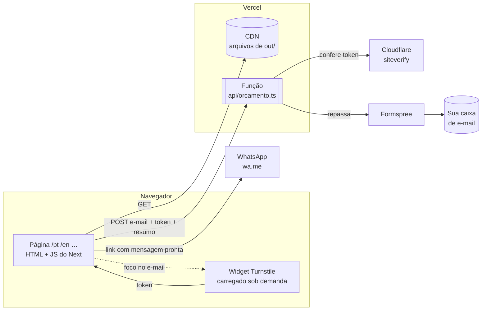
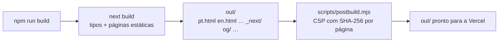

# Visão geral da arquitetura

## Em uma frase

Um site **estático** (HTML pronto, gerado no build) em 5 idiomas, servido pela CDN da Vercel,
com **uma única função serverless** (`/api/orcamento`) para o envio de orçamento por e-mail.

## Stack

| Camada        | Escolha                                   | Por quê                                         |
| ------------- | ----------------------------------------- | ----------------------------------------------- |
| Framework     | Next.js 16 (App Router), `output: "export"` | HTML estático por idioma, React só onde precisa — [ADR-0001](../decisoes/0001-site-estatico-nextjs.md) |
| Linguagem     | TypeScript (strict)                       | Dicionários e preços tipados: erro de digitação quebra o build |
| UI            | React 19                                  |                                                 |
| CSS           | CSS do design portado em `globals.css`    | Fidelidade ao design — [ADR-0002](../decisoes/0002-css-portado-sem-tailwind.md) |
| Fontes        | `next/font` (Plus Jakarta Sans, JetBrains Mono) | Hospedadas no próprio site, sem Google no navegador |
| Hospedagem    | Vercel, modo estático (`framework: null`) | [ADR-0009](../decisoes/0009-vercel-estatico-puro.md) |
| E-mail        | Função Vercel → Cloudflare Turnstile → Formspree | [ADR-0013](../decisoes/0013-funcao-turnstile-formspree.md) |
| Testes        | Vitest (+ Testing Library, jsdom) e Playwright | [ADR-0015](../decisoes/0015-testes-em-quatro-camadas.md) |

## Como as peças conversam



- **Tudo que é visual** sai pronto do build: não há servidor renderizando páginas.
- **WhatsApp** é só um link (`wa.me/<número>?text=<mensagem>`); nada passa pelo nosso servidor.
- **E-mail** é o único caminho com backend, e o navegador nunca fala com o Formspree
  (o ID fica no servidor). Detalhes em [dominio/contato-e-leads.md](../dominio/contato-e-leads.md).

## Pastas

```
api/orcamento.ts        função serverless (Vercel detecta a pasta api/ sozinha)
src/
  app/
    [lang]/             layout + página de cada idioma (root layout por idioma)
    (root)/             "/" → escolhe o idioma e redireciona
    global-not-found.tsx 404 única
    sitemap.ts robots.ts manifest.ts
    fonts.ts
  components/           uma seção da página por arquivo + estado (QuoteProvider)
  config/               site.ts (marca, contato, idiomas) · pricing.ts (preços e regras)
  i18n/                 pt.ts define o formato; en/es/fr/de seguem
  lib/                  lógica sem React: calc, format, whatsapp, seo, jsonld, turnstile, icons
  styles/globals.css    CSS do design
  assets/projects/      prints dos cases (WebP, importados pelo next/image)
public/                 favicon, ícones, imagens OG, foto
scripts/
  generate-assets.mjs   gera ícones, imagens OG, WebP/AVIF (rodar à mão: npm run assets)
  postbuild.mjs         grava a CSP com hashes em cada HTML (roda no build)
  serve.mjs             servidor local que imita a Vercel (npm start, testes)
tests/                  unit · components · integration · e2e
dantas-studio-handoff/  design aprovado + imagens originais (fonte da verdade visual)
docs/                   esta documentação
```

Regra de ouro (do briefing): **preço, texto, WhatsApp e idiomas mudam só em `src/config/` e
`src/i18n/`.** Os componentes não precisam ser tocados para isso.

## Build



- `generateStaticParams` gera `/pt`, `/en`, `/es`, `/fr`, `/de`. Cada um é um HTML completo,
  com textos, preços na moeda padrão do idioma e metadados de SEO.
- O `next build` também confere os tipos do projeto inteiro (inclusive os testes).
- A Vercel publica `out/` e, à parte, empacota `api/orcamento.ts` como função.

## O que roda onde

| Onde                    | O quê                                                                     |
| ----------------------- | ------------------------------------------------------------------------- |
| Build (Node)            | Todas as seções, textos, SEO, JSON-LD, sitemap, imagens                   |
| Navegador, logo ao abrir | Script de tema (inline), hidratação do React, relógio, checklist animado, reveal, spotlight |
| Navegador, sob demanda  | Turnstile (só ao focar no campo de e-mail), foto do "Sobre" (lazy)         |
| Função Vercel           | Validação + Turnstile + Formspree, só no envio do e-mail                   |

Mais em [renderizacao-e-estado.md](renderizacao-e-estado.md).
