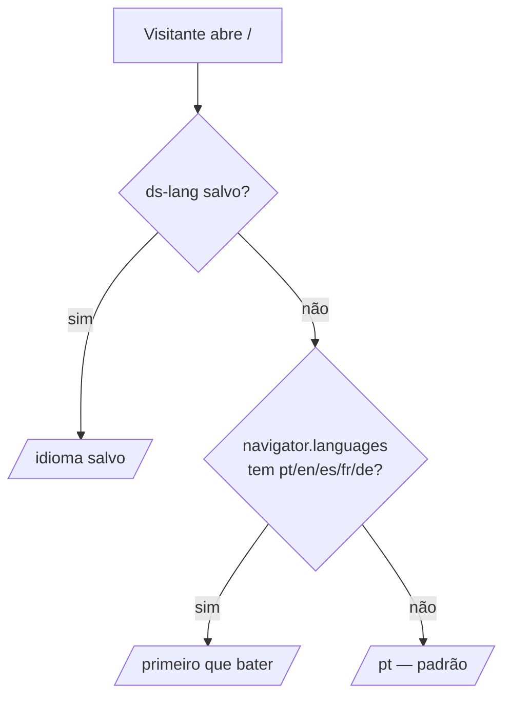

# Idiomas e regiões

## Idiomas

- Rotas: `/pt` `/en` `/es` `/fr` `/de`, uma página estática cada (`LOCALES` em `src/config/site.ts`).
- Textos: `src/i18n/<idioma>.ts`. **`pt.ts` define o formato**; os outros são tipados como
  `Dictionary` (= `typeof pt`), então faltar ou sobrar uma chave quebra o build.
- `tests/unit/i18n.test.ts` confere também: mesma quantidade de itens nas listas, nenhum texto
  vazio, títulos sem espaço duplo, limites de tamanho do título/descrição do Google.
- Os textos originais foram **extraídos do design por script**, não redigitados
  ([ADR-0006](../decisoes/0006-textos-extraidos-do-design.md)). Chaves acrescentadas depois:
  `meta.*`, `ui.lang/currency/nav/less/more`, `calc.sending/error/emailLabel`.

### Escolha do idioma

O redirecionamento é um script inline em `/` (`redirectScript()` em `src/lib/seo.ts`); sem JS,
há `<meta http-equiv="refresh">` para `/pt` e links para todos os idiomas.

Trocar o idioma no seletor salva `ds-lang`, apaga a moeda salva e navega para
`/<idioma>#<âncora atual>` (recarrega a página).

## Regiões (moeda)

A região é **independente do idioma** ([ADR-0004](../decisoes/0004-regiao-independente-do-idioma.md)):

| Idioma | Região padrão |
| ------ | ------------- |
| pt     | BR            |
| en     | US            |
| es     | US (dólar)    |
| fr, de | EU            |

O visitante pode escolher qualquer moeda; a escolha fica em `ds-region`. Um alemão pode ver em
libras, um brasileiro no exterior pode ver em reais.

## Adicionar um idioma

Passo a passo em [operacao/manutencao.md](../operacao/manutencao.md#adicionar-um-idioma).
